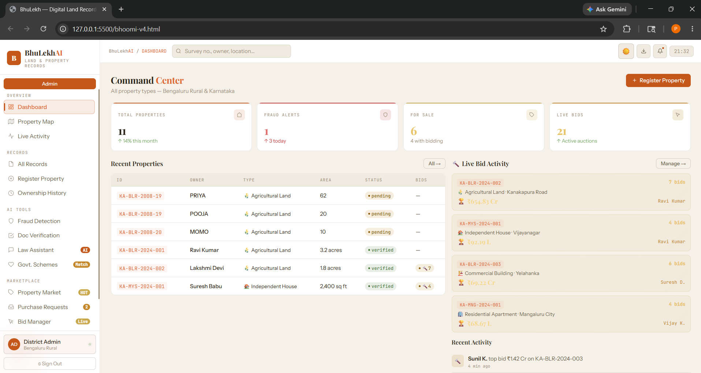
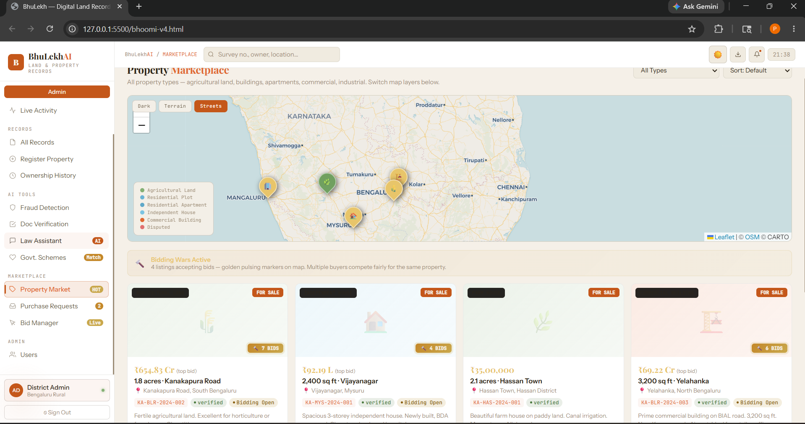
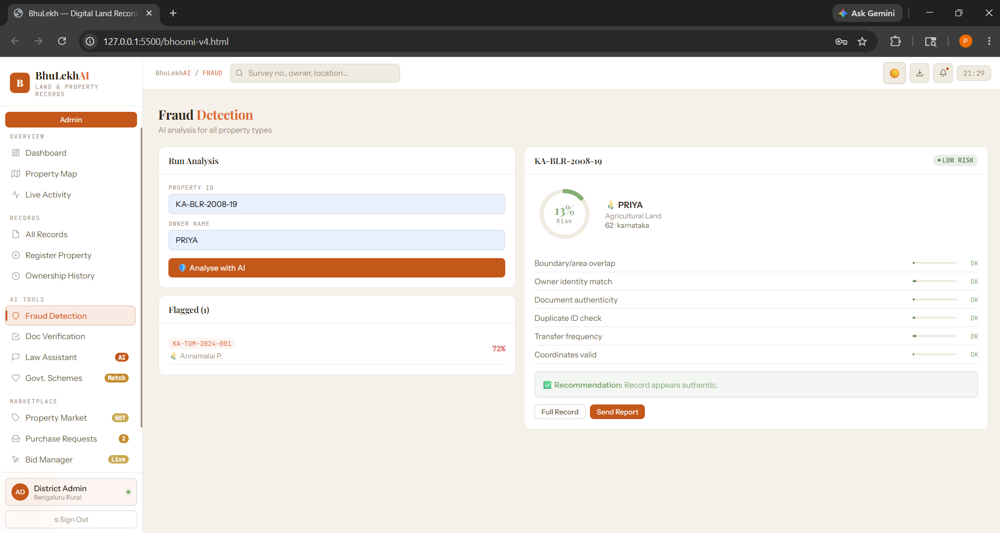
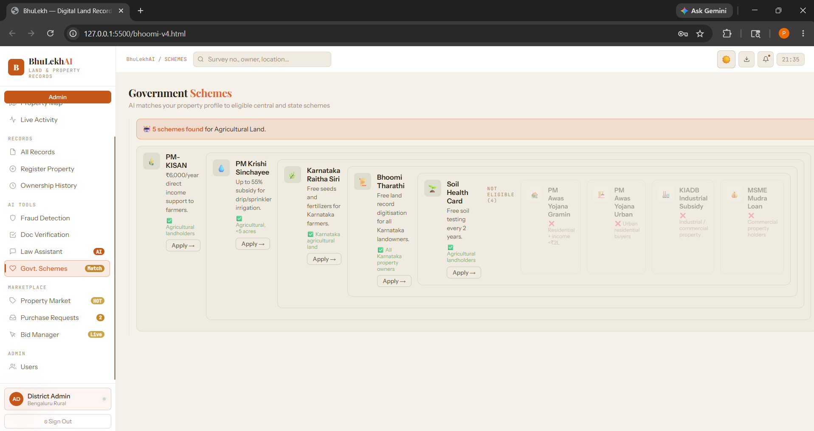

# BhuLekhAI – Digital Land & Property Records Management System

A full-stack web application inspired by Karnataka's Bhoomi portal for secure digital land record management. The system provides separate dashboards for administrators and citizens, enabling efficient property management, ownership verification, fraud detection, document verification, and property marketplace services.

---

## Features

### Admin Portal

- Secure Admin Login with CAPTCHA verification
- Dashboard with property statistics and live activity
- View and manage all land records
- Register new properties
- Track ownership history
- Interactive Property Map
- Fraud Detection using Property ID and Owner details
- Document Verification
- Law Assistant for property-related legal information
- Government Schemes Recommendation
- Property Marketplace
- Purchase Request Management
- Bid Management System

### Citizen Portal

- Secure Citizen Login with CAPTCHA verification
- Personal Dashboard
- View owned properties
- Property Map
- Property Ownership History Search
- Buy and Sell Properties
- Property Marketplace
- Government Scheme Eligibility
- Law Assistant

---

## Technology Stack

### Frontend
- HTML5
- CSS3
- JavaScript

### Backend
- Node.js
- Express.js

### Database
- SQLite

---

## Login Credentials

### Admin

Username: admin

Password: admin123

### Citizen

Username: Ravi

Password: Ravi123

---

## Project Screenshots

### Login Page

### Admin Dashboard

### Property Market

### Fraud Detection

### Government Schemes

---

## Project Modules

### Property Management
- Register properties
- View property records
- Property ownership history

### Fraud Detection
- Detect duplicate property registrations
- Flag suspicious property records

### Document Verification
- Upload land-related documents
- Verify submitted documents

### Property Marketplace
- Buy and Sell Properties
- Purchase Requests
- Bid Management

### Government Services
- Government Scheme Recommendation
- Property Law Assistance

---

## Security Features

- Role-based authentication
- Separate Admin and Citizen dashboards
- CAPTCHA verification during login
- Property ownership validation
- Fraud detection module

---

## How to Run Locally

1. Clone the repository

git clone <repository-url>

2. Install dependencies

npm install

3. Start the server

node server.js

4. Open the application in your browser.

---

## Future Enhancements

- Aadhaar-based authentication
- Email and SMS notifications
- AI-powered fraud prediction
- Online property registration
- Digital signature support
- Cloud deployment

---

## Developed By

Developed as an academic full-stack project for digital land record management.

